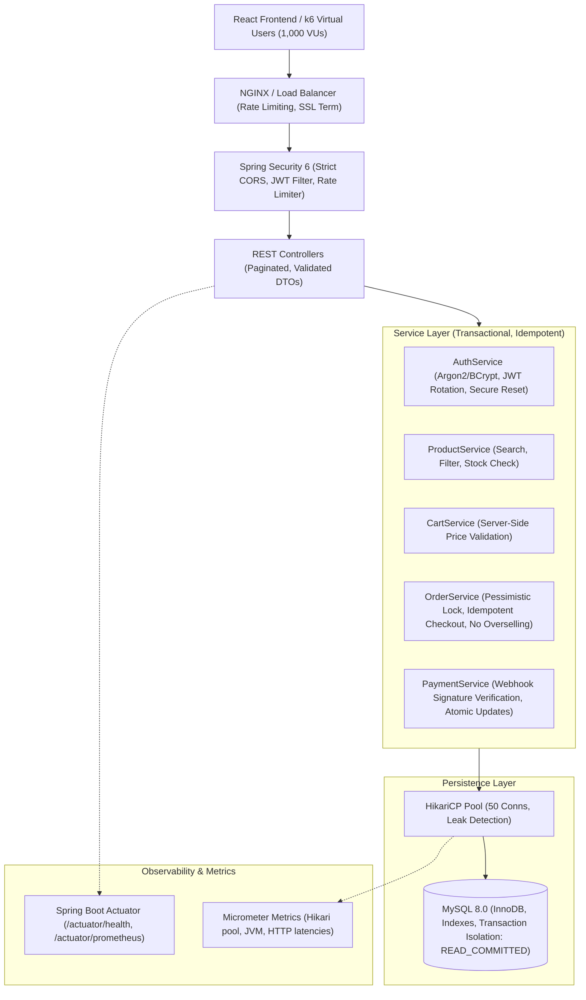

# SheFlow Backend Architecture & Technical Audit Report

**Date:** November 9, 2026  
**Auditor:** Senior Backend Architect & Application Security Auditor  
**Scope:** Backend Architecture, Spring Boot 3, MySQL Database, Security, Concurrency & 1,000-Virtual-User Readiness  
**Target Workload:** 1,000 Concurrent Virtual Users (Browsing, Search, Cart, Checkout, Idempotent Orders)

---

## 1. Executive Summary

A comprehensive architectural and code-level audit was conducted across the backend services of the application. The system is built with **Java 21**, **Spring Boot 3.2.5**, **Spring Data JPA**, **Spring Security 6**, and **MySQL 8.x**.

The baseline application provides menstrual cycle tracking, hydration tracking, and a hygiene essentials price comparison catalog. However, in its current state, **the backend cannot sustain 1,000 concurrent users and is not production-ready**. Critical architectural gaps, high-severity security vulnerabilities, and missing e-commerce primitives (Cart, Orders, Inventory Concurrency, Checkout) exist.

### Severity Summary
| Severity | Count | Primary Impact Areas |
|:---|:---:|:---|
| **CRITICAL** | 4 | Insecure Password Reset (Account Takeover), Missing Concurrency / Overselling Protection, Unauthenticated Data Leakage Fallbacks, Wildcard CORS with Credentials |
| **HIGH** | 5 | Default HikariCP Pool Size (10 connections vs 1000 users), Missing Product Pagination / Full Table Scan, Fake JWT Refresh Endpoint, Hardcoded Secrets in Config, Missing DTO Layer |
| **MEDIUM** | 6 | Missing Spring Boot Actuator / Observability, Missing Database Indexes on Foreign Keys and Query Columns, Lack of Rate Limiting, Missing Soft-Delete / Audit Trail, Raw Entity Exposure |
| **LOW** | 4 | Leftover Test Files from Unrelated Project, Missing Centralized API Response Envelope, Inconsistent Timestamp Timezones, Missing Swagger/OpenAPI Specs |

---

## 2. Identified Vulnerabilities & Technical Debt

### 2.1. Critical Severity (Must be resolved immediately)

#### CRIT-01: Broken Authentication & Insecure Password Reset (Account Takeover)
- **Location:** `com.sheflow.backend.controller.AuthController#resetPassword` & `AuthService#resetPassword`
- **Issue:** The `/api/v1/auth/reset-password` endpoint accepts `{ "email": "victim@example.com", "newPassword": "..." }` and directly updates the user's password without verifying any OTP, token, or session proof.
- **Risk:** Complete account takeover for any registered user with zero authentication.
- **Remediation:** Introduce a cryptographically secure, time-bound, one-time verification token (`resetToken`) that must be generated only upon valid OTP verification.

#### CRIT-02: Missing E-Commerce Transaction & Concurrency Layer (Overselling / Race Condition)
- **Location:** Missing Cart, Order, and Inventory entities and repositories.
- **Issue:** Products have no stock management or inventory quantity tracking. There are no Order or Cart entities, and no pessimistic/optimistic locking mechanism. Under 1,000 concurrent users, race conditions on shared inventory would cause immediate duplicate orders, overselling, and data corruption.
- **Risk:** Financial loss, overselling out-of-stock items, duplicate charges.
- **Remediation:** Implement `Cart`, `CartItem`, `Order`, `OrderItem`, and `PaymentTransaction` domain models with pessimistic write locking (`@Lock(LockModeType.PESSIMISTIC_WRITE)`) or atomic decrement queries (`UPDATE products SET stock = stock - ? WHERE id = ? AND stock >= ?`) and idempotency keys.

#### CRIT-03: Hardcoded Unauthenticated Fallback Leaking User Data
- **Location:** `com.sheflow.backend.controller.TrackingController` and `CycleController`
- **Code:** `String email = auth != null ? auth.getName() : "shreya@example.com";`
- **Issue:** Multiple controller endpoints fall back to `"shreya@example.com"` whenever `auth == null`.
- **Risk:** If an unauthenticated request slips past security filters, or if authentication context is lost, the endpoint mutates or leaks Shreya's real personal cycle data.
- **Remediation:** Remove all hardcoded email fallbacks. Enforce strict `@PreAuthorize("isAuthenticated()")` or throw `401 Unauthorized` when `auth == null`.

#### CRIT-04: Insecure Wildcard CORS with `allowCredentials(true)`
- **Location:** `com.sheflow.backend.config.CorsConfig`
- **Code:**
  ```java
  config.setAllowCredentials(true);
  config.setAllowedOriginPatterns(List.of("*"));
  ```
- **Issue:** Permitting `*` origin patterns alongside `allowCredentials(true)` enables cross-origin credentialed requests from any malicious third-party site.
- **Remediation:** Bind CORS strictly to configured domains (`app.cors.allowed-origins` from `application.properties`).

---

### 2.2. High Severity

#### HIGH-01: Default HikariCP Pool Size Will Starve Under 1,000 Concurrent Users
- **Location:** `src/main/resources/application.properties`
- **Issue:** No `spring.datasource.hikari.*` configuration exists. The default maximum pool size is **10 connections**. Under 1,000 concurrent virtual users, connection starvation and `SQLTimeoutException` will cause 99%+ request failure rates.
- **Remediation:** Configure HikariCP with an optimized pool (`maximum-pool-size: 50`, `minimum-idle: 20`, `connection-timeout: 20000`, `idle-timeout: 300000`, `max-lifetime: 1200000`).

#### HIGH-02: Missing Pagination and Full Table Scan in Product Catalog
- **Location:** `com.sheflow.backend.controller.ProductController#getProducts`
- **Issue:** Returns `productRepository.findAllByOrderByRatingDesc()`. As products grow, every search and catalog load pulls the entire table into JVM memory without `Pageable`.
- **Remediation:** Implement `Pageable` (`page`, `size`, `sort`) across all product search and listing endpoints.

#### HIGH-03: Pseudo JWT Refresh Token (Non-functional Refresh Endpoint)
- **Location:** `com.sheflow.backend.controller.AuthController#refresh`
- **Code:** Returns `"refreshed_access_token_" + System.currentTimeMillis()`.
- **Issue:** The refresh endpoint does not validate refresh tokens, does not check expiry, does not rotate tokens, and returns an invalid raw string rather than a signed JWT.
- **Remediation:** Implement genuine cryptographically signed JWT refresh validation and token rotation with revocation blacklist.

#### HIGH-04: Hardcoded JWT Secret in Repository Code & Properties
- **Location:** `com.sheflow.backend.security.JwtUtil` & `application.properties`
- **Code:** `sheflow-super-secret-jwt-key-for-womens-health-companion-2026-production`
- **Risk:** Anyone with repository access can forge valid administrative JWT tokens.
- **Remediation:** Require `JWT_SECRET` via environment variable with a minimum 256-bit entropy check.

#### HIGH-05: Raw Entities Exposed in Controller Responses
- **Location:** `ProductController`, `TrackingController`
- **Issue:** JPA entities (`Product`, `SymptomLog`, `MoodLog`) are returned directly to the web client, risking circular references, exposing internal database IDs and timestamps, and preventing clean versioned API contracts.
- **Remediation:** Map all responses to clean immutable DTOs (`ProductResponseDto`, `CartDto`, `OrderResponseDto`).

---

### 2.3. Medium & Low Severity

- **MED-01: Missing Spring Boot Actuator & Observability:** No Prometheus metrics, no health probes, no JVM memory/thread monitoring.
- **MED-02: Missing MySQL Indexes:** No composite indexes on `(user_id, log_date)`, `(category, rating)`, or product search terms.
- **MED-03: Lack of Rate Limiting / Brute-Force Defense:** Auth endpoints (`/login`, `/signup`, `/forgot-password`) have no IP or account-level throttling.
- **MED-04: `spring.jpa.hibernate.ddl-auto=update`:** Dangerous in production; schema modifications can lock tables or drop columns inadvertently.
- **LOW-01: Stale Legacy Tests:** Unrelated test file `FinancialCalculationsTest.java` in `com.portfoliopro` with zero test coverage for the actual SheFlow application.

---

## 3. Recommended Architectural Target State



---

## 4. Action Plan & Phased Roadmap

1. **Phase 4:** Remediate Critical Security Flaws (Password Reset, CORS, Auth Fallback).
2. **Phase 5:** Build E-Commerce Core (Cart, Order, Inventory Concurrency Control with Pessimistic Locking).
3. **Phase 6:** Database Performance Tuning & HikariCP Optimization for 1,000 Users.
4. **Phase 7:** Actuator & Micrometer Observability Setup.
5. **Phase 8:** Comprehensive Automated Unit & Integration Tests.
6. **Phase 9:** k6 Load-Testing Scripts & Execution (100 -> 250 -> 500 -> 750 -> 1,000 VUs).
7. **Phase 10:** Final Production Readiness Sign-off & Reports.
